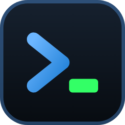
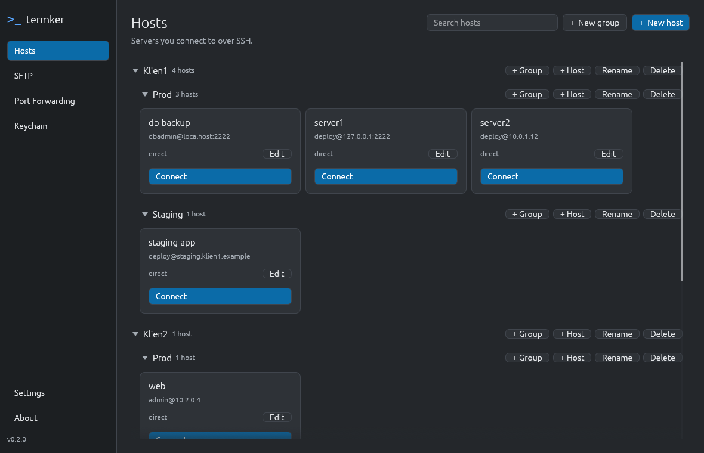
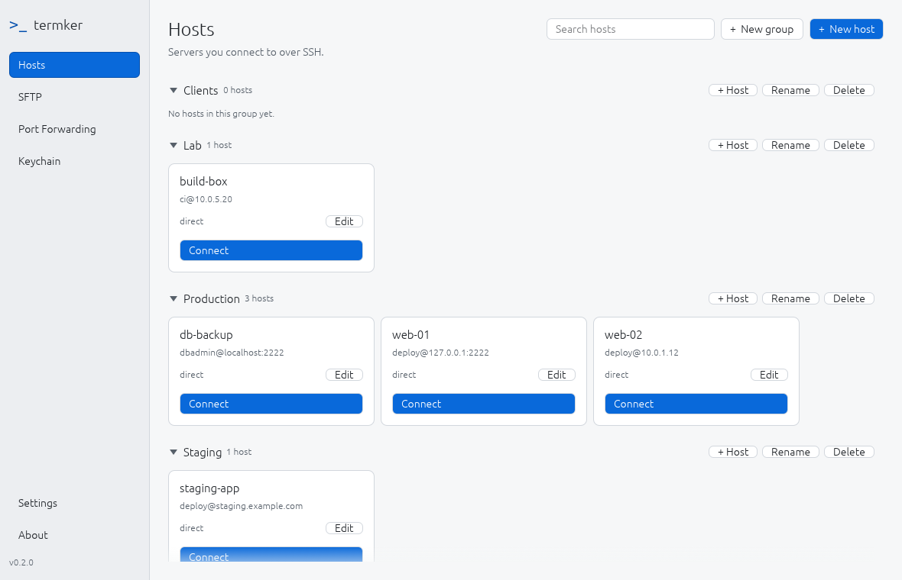
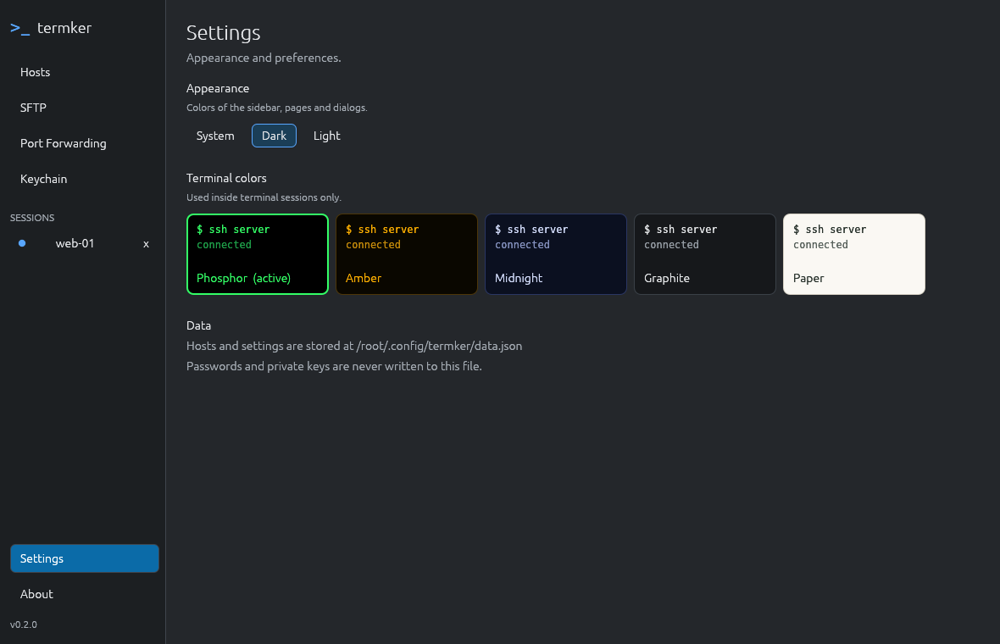
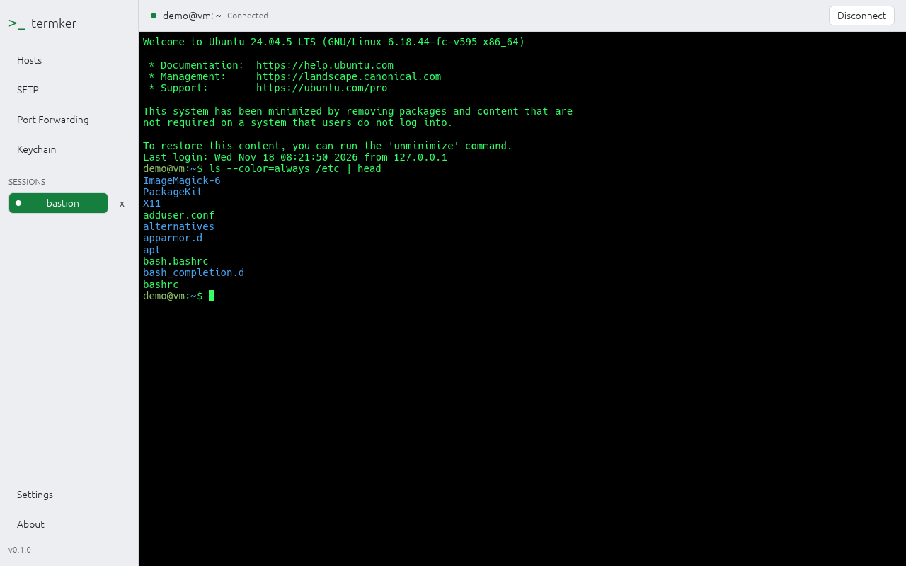
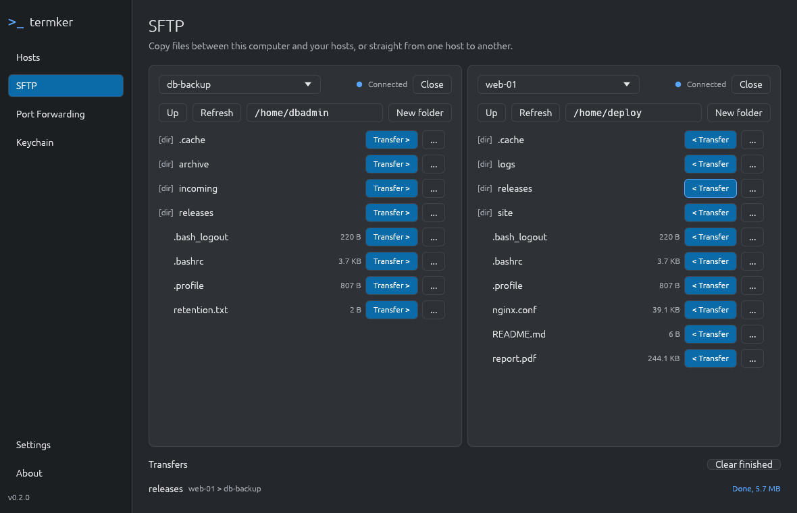
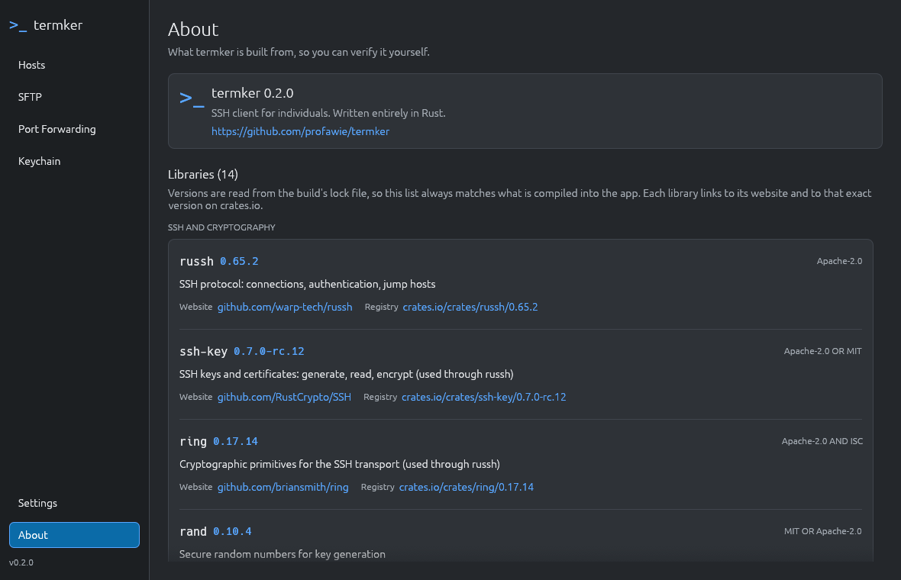

# termker

A desktop SSH client for individuals, written entirely in Rust. Runs on Windows and macOS.

Version: 0.2.0

| Dark | Light |
| --- | --- |
|  |  |
|  |  |
|  |  |

## Features

| Feature | Status |
| --- | --- |
| Host management with search and groups, including groups inside groups (Client > Prod > server), that you can add, rename, collapse and delete; drag a host onto a group to move it | Done |
| Dark, light or system appearance for the app; separate terminal color themes (default: green text on black) | Done |
| About screen listing every library, its version and website | Done |
| SSH terminal (password or key file) with host key verification | Done |
| Jump server (ProxyJump), any number of hops | Done |
| Port forwarding: local, remote and dynamic (SOCKS5) | Done |
| SFTP: two panes side by side, each showing this computer or a host; drag files and folders from one pane to the other to copy them, including host to host; rename, delete, new folder | Done |
| Keychain: generate and import keys (ED25519, ECDSA, RSA), identities, OpenSSH user certificates | Done |
| Saved passwords and passphrases in the OS credential store (opt-in) | Done |
| FIDO2 security keys | Planned |

## Build and run

Requires [Rust](https://rustup.rs) 1.92 or newer.

```
./run.sh                                              # macOS and Linux
powershell -ExecutionPolicy Bypass -File .\run.ps1    # Windows, GNU toolchain
```

Both make a debug build, which compiles faster; add `--release` (`-Release`
for `run.ps1`) for an optimized build. `run.ps1` has the same requirements as
`build.ps1` below and needs no Microsoft build tools.

### Release packages

The build scripts make a release build and package it in `dist/`.

**Windows**, with the GNU toolchain, so no Visual Studio or Microsoft build
tools are needed:

1. Install rustup from [rustup.rs](https://rustup.rs). If it is not installed
   yet, run the installer as `rustup-init.exe --default-host x86_64-pc-windows-gnu -y`.
2. Install a 64-bit MinGW-w64 gcc (MSVCRT build), for example
   `winget install -e --id BrechtSanders.WinLibs.POSIX.MSVCRT`, or MSYS2 with
   `pacman -S mingw-w64-x86_64-gcc`. Open a new terminal afterwards.
3. Run:

   ```powershell
   powershell -ExecutionPolicy Bypass -File .\build.ps1
   ```

The script installs Rust's `stable-x86_64-pc-windows-gnu` toolchain if it is
missing, writes `dist\termker-<version>-windows-x86_64.zip`, and copies
`termker.exe` to the repository folder. The `.exe` needs no other files.

**macOS and Linux:**

```
./build.sh             # .app in a .zip on macOS, .tar.gz on Linux
./build.sh --windows   # Windows .zip, cross-built with MinGW-w64
```

Both also copy the program to the repository folder (`termker`,
`termker.app` or `termker.exe`). The macOS app is not signed. On first launch, right-click it and choose Open.

## Tests

```
cargo test
```

This runs the tests of every crate in the workspace.

## Code layout

The code is a Cargo workspace. It still builds into one program; the crates
only keep the parts separate.

| Crate | What it does |
| --- | --- |
| `termker` (`src/`) | The desktop app: windows, pages, themes, About screen |
| `termker-core` (`crates/core`) | Saved hosts and settings, keychain keys and identities, saved passwords |
| `termker-ssh` (`crates/ssh`) | SSH connections, host keys, jump hosts, port forwarding, SFTP |
| `termker-terminal` (`crates/terminal`) | Terminal emulator and interactive shell sessions |

Each crate only depends on the ones below it in this list: the app uses all
three, `termker-terminal` uses `ssh` and `core`, and `termker-ssh`
uses `core`. Third-party libraries are declared once, under
`[workspace.dependencies]` in the root `Cargo.toml`.

## Data

Hosts and settings are stored as JSON in the per-user config folder
(`%APPDATA%\termker\config\data.json` on Windows,
`~/Library/Application Support/termker/data.json` on macOS).
Passwords and private keys are never written to this file.

This app was called rterminalfy before. On first start, termker moves the
old `rterminalfy` folder to its own folder and moves saved passwords to its
own credential store entries, then says so at the top of the window. If a
`termker` folder already exists, nothing is moved or overwritten.

Passwords and key passphrases are asked for when connecting. If you tick
"Remember", they are saved in the operating system's credential store
(Windows Credential Manager or the macOS Keychain), never in a file of this
app. A `secrets.json` file lists the names of what was saved, without the
secrets, so the Keychain page can show the list and remove entries.

Keys in the keychain are stored as one OpenSSH private key file each in a
`keys` folder next to `data.json`, readable only by your user account. A key
is encrypted on disk when you give it a passphrase; without one it is stored
unencrypted, like a key in `~/.ssh`. Public keys and certificates are public
material and are kept in `data.json`.

Trusted host keys are kept in a `known_hosts` file in the same folder, in the
OpenSSH format. Your own `~/.ssh/known_hosts` is never modified.

## Libraries

Every library used is listed on the About screen with its version and
website. Versions are read from `Cargo.lock` at build time, and a test fails
if a library in `Cargo.toml` is not listed. The cryptography libraries that
come in through `russh` (`ssh-key` and `ring`) are listed too.

## License

Licensed under either of [Apache License, Version 2.0](LICENSE-APACHE) or
[MIT license](LICENSE-MIT) at your option.
